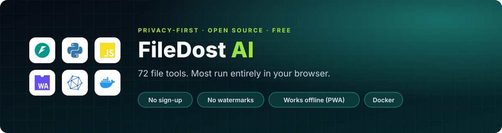
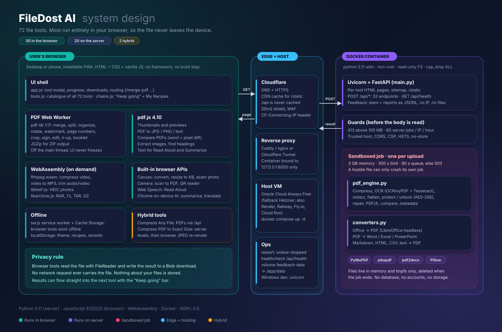

<p align="center">
  
</p>

<p align="center">
  
  
  
  
  
  
</p>

<p align="center">
  <a href="#-tools">Tools</a> ·
  <a href="#-run-it">Run it</a> ·
  <a href="#-tests">Tests</a> ·
  <a href="#-project-layout">Layout</a> ·
  <a href="docs/TOOLS-README.md">Full tool guide</a> ·
  <a href="DEPLOY.md">Deploy</a>
</p>

---

> **Free, open-source PDF tools. No sign-up, no watermarks, no limits on use.**

<table>
<tr>
<td width="50%" valign="top">

### 🔒 Privacy model
Tools marked **"Runs on your device"** process the file in your browser with [pdf-lib](https://pdf-lib.js.org); the file is never uploaded.

The other tools send the file to the server, which processes it in memory and does not write it to disk or keep it.

</td>
<td width="50%" valign="top">

### ⚡ Built for speed
Browser tools run in a background **Web Worker**, so large files don't freeze the page. Thumbnails and previews are drawn with [pdf.js](https://mozilla.github.io/pdf.js/).

The app is **installable** and, after the first visit, the browser tools **work offline** (service worker in `static/sw.js`).

</td>
</tr>
</table>

## 🏗️ System design

<p align="center">
  
</p>

## 🧰 Tools

Every tool has its own address (`/merge-pdf`, `/compress-pdf`, ...) with its own title and description, and `/sitemap.xml` lists them all for search engines.

| Tool | Where it runs | What it does |
| :--- | :---: | :--- |
| Merge | 🟢 Your device | Combines PDFs; drag pages in the grid to reorder, turn or delete any page |
| Split | 🟢 Your device | Click pages (or type `1-3, 5`) to pull out, or save every page as its own file (ZIP) |
| Organize | 🟢 Your device | Page grid: drag to reorder, turn, delete, reverse |
| Remove Pages | 🟢 Your device | Click the pages to drop |
| Rotate | 🟢 Your device | Click a page to turn it, or turn all pages |
| Images to PDF | 🟢 Your device | JPG/PNG directly, WebP/GIF/BMP converted in the browser |
| PDF to JPG | 🟢 Your device | Each page as JPG or PNG at 72, 150 or 300 dpi |
| PDF to Text | 🟢 Your device | Text as Markdown, via pdf.js |
| Sign | 🟢 Your device | Draw, type or upload a signature and click where it goes; works on rotated pages |
| Watermark | 🟢 Your device | Centred text stamp with opacity, angle and size |
| Page Numbers | 🟢 Your device | `Page {n} of {total}` style labels in 6 positions |
| Edit Metadata | 🟢 Your device | Title, author, subject, keywords |
| Compress | 🔵 Server | **Low**: lossless clean-up. **Recommended**: images downsampled to 150 dpi, JPEG q75. **Extreme**: 72 dpi, q45. Never returns a bigger file. |
| OCR | 🔵 Server | Tesseract via OCRmyPDF adds a searchable, selectable text layer to scanned pages |
| Redact | 🔵 Server | Finds emails, phone numbers and keywords, deletes the text underneath (PyMuPDF redactions) and draws black boxes; also scrubs matches from metadata |
| Flatten | 🔵 Server | Burns form-field values and annotations into the page |
| Protect / Unlock | 🔵 Server | AES-256 password encryption / decryption |
| PDF to Word | 🔵 Server | Text extraction (layout, tables and images are not kept yet) |
| Document Insights | 🔵 Server | Word count, reading time, frequent words, opening sentences. Plain statistics, no AI model |
| Chained Pipeline | 🔵 Server | Watermark, page numbers, rotate, redact and compress in one pass |

API-only for now: compare. See **[docs/TOOLS-README.md](docs/TOOLS-README.md)** for the full tool guide.

## 🚀 Run it

Needs **Python 3.11+**, plus `tesseract-ocr` and `ghostscript` for OCR (`apt install tesseract-ocr ghostscript`, `brew install tesseract ghostscript`, or the Windows installers). Without them every tool except OCR still works, and OCR returns a clear "not installed" error.

```bash
pip install -r requirements.txt
./run.sh            # or: python3 -m uvicorn main:app --port 8000
```

Open http://localhost:8000. API docs are at http://localhost:8000/docs.

**🐳 Docker**

```bash
docker build -t filedost . && docker run -p 8000:8000 filedost
```

<details>
<summary><b>⚙️ Server settings (environment variables)</b></summary>

| Variable | Default | Meaning |
| :--- | :--- | :--- |
| `ULTRAPDF_MAX_UPLOAD_MB` | 100 | Largest upload accepted by server tools (413 above it) |
| `ULTRAPDF_RATE_LIMIT` | 60 | Server-tool requests per IP per window; 0 turns it off |
| `ULTRAPDF_RATE_WINDOW_SEC` | 3600 | Rate-limit window |
| `ULTRAPDF_TRUST_PROXY` | off | Set to `1` behind a reverse proxy so the limit uses `X-Forwarded-For` |

</details>

## 🧪 Tests

```bash
python3 -m pytest tests     # correctness tests (engine + in-browser tools; the latter need Node)
python3 test_suite.py       # original end-to-end API smoke test

# Real-browser check (page grid, sign, offline, size limit, phone layout):
npm install
ULTRAPDF_MAX_UPLOAD_MB=1 python3 -m uvicorn main:app --port 8765 &
npm run test:e2e
```

The correctness tests check **results, not just that a file came back**:

- ✅ redacted text is gone from the file bytes
- ✅ OCR output contains the scanned words
- ✅ compression levels produce progressively smaller files at the target dpi
- ✅ flattened forms keep their values
- ✅ pages land in the right order
- ✅ a signature lands where it was clicked on pages rotated 0, 90, 180 and 270 degrees

## 📁 Project layout

<details>
<summary><b>Show the layout</b></summary>

```text
main.py                  FastAPI routes, per-tool pages, sitemap, static files
guards.py                Upload size limit and per-IP rate limit
pdf_engine.py            Server-side engine (pypdf, PyMuPDF, OCRmyPDF, ReportLab, Pillow, python-docx)
static/tools.js          Tool catalogue: each tool's options and handler
static/app.js            App shell: tool grid, modal, routing, downloads
static/client-tools.js   In-browser PDF operations (pdf-lib, JSZip), also loadable from Node for tests
static/pdf-worker.js     Web Worker that runs client-tools.js off the main thread
static/page-board.js     Thumbnail page grid (drag, rotate, delete, select)
static/render-tools.js   pdf.js helpers: previews, PDF to JPG, PDF to text
static/sign-tool.js      Signature pad and placement
static/sw.js             Service worker for offline use
static/vendor/           pdf-lib 1.17.1, JSZip 3.10.1 (MIT), pdf.js 4.10.38 (Apache-2.0), served locally
tests/                   pytest tests, the Node harness for browser tools, and the Playwright check
```

</details>

## 📜 License

PyMuPDF and Ghostscript are AGPL-3.0, so FileDost AI as a whole is distributed under **AGPL-3.0**: anyone running a modified version as a public service must publish their source.

The fonts in `static/fonts/` (Geist, Geist Mono, Caveat, Dancing Script and Great Vibes) are under the SIL Open Font License 1.1; the license texts sit next to them. The icons in `static/icons.js` are FileDost AI's own.

<p align="center"><sub>Made by <a href="https://github.com/Rohesen">Rohesen Rajkamal Maurya</a> · if FileDost AI is useful to you, a ⭐ helps</sub></p>
