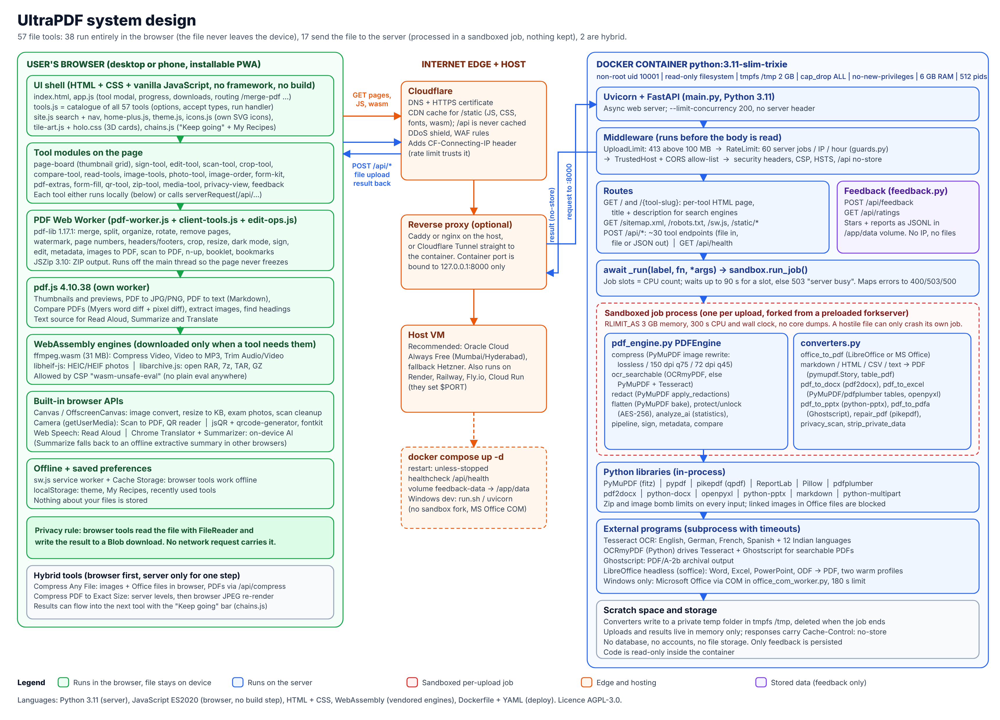

# FileDost AI: how it is built and how every tool works

FileDost AI is a free, open-source (AGPL-3.0) web app with 57 file tools for PDFs, images, Office files, archives, audio and video. It is built so that as much work as possible happens **inside the visitor's browser**, and only the jobs that need heavy desktop-class engines (LibreOffice, Tesseract, Ghostscript, PyMuPDF) go to the server.

| Where it runs | Tools | What happens to the file |
| :--- | ---: | :--- |
| Browser only | 38 | Read with FileReader, processed in JavaScript or WebAssembly, saved as a download. Never uploaded. |
| Server | 17 | Uploaded over HTTPS, processed in memory inside a sandboxed job process, sent back, then discarded. |
| Hybrid | 2 | Browser does most of the work and calls the server for one step (PDF compression). |

---

## 1. Programming languages

| Language | Where | What it is used for |
| :--- | :--- | :--- |
| **Python 3.11** | `main.py`, `pdf_engine.py`, `converters.py`, `sandbox.py`, `guards.py`, `feedback.py`, `office_com_worker.py` (about 3,900 lines) | Web server (FastAPI), every server tool, security guards, the job sandbox |
| **JavaScript (ES2020, plain, no framework, no build step)** | `static/*.js` (about 14,600 lines) | The whole user interface and the 38 in-browser tools, Web Workers, service worker |
| **HTML + CSS** | `static/index.html`, `static/*.css` (about 4,700 lines of CSS) | Page layout, themes (dark/light), hologram 3D tool cards, glass navigation |
| **WebAssembly** | `static/vendor/ffmpeg`, `libarchive`, `libheif-bundle.js`, pdf.js | Ready-made engines compiled from C/C++ that run in the browser (video, HEIC photos, RAR/7z) |
| **Dockerfile, YAML, shell** | `Dockerfile`, `docker-compose.yml`, `run.sh` | Packaging and deployment |
| **Python tests (pytest) + Node/Playwright** | `tests/` | Correctness tests for engines and end-to-end tests in a real Chromium browser |

## 2. Libraries and engines

### In the browser (all served from `static/vendor/`, nothing loaded from other sites)

| Library | Version / licence | Used for |
| :--- | :--- | :--- |
| **pdf-lib** | 1.17.1, MIT | Creating and changing PDFs: merge, split, rotate, stamp text and images, forms, bookmarks, metadata |
| **pdf.js** (Mozilla) | 4.10.38, Apache-2.0 | Drawing pages (thumbnails, previews, PDF to JPG), reading text, finding images |
| **JSZip** | 3.10.1, MIT | Making and opening ZIP files; shrinking pictures inside .docx/.xlsx/.pptx |
| **fontkit** | MIT | Embedding real fonts so form filling works with Hindi and other non-Latin letters |
| **ffmpeg.wasm** | single-thread core, GPL-2.0+ | Compress video, video to MP3, trim audio/video (31 MB, downloaded only on first use) |
| **libheif-js** | 1.19.8, LGPL-3.0 | Decoding iPhone HEIC/HEIF photos |
| **libarchive.js** | MIT | Opening RAR, 7z, TAR and GZ archives |
| **qrcode-generator** | MIT | Making QR codes (links, Wi-Fi, UPI, contact cards) |
| **jsQR** | Apache-2.0 | Reading QR codes from photos, PDFs or the camera |
| **Browser APIs** | built in | Canvas/OffscreenCanvas (image work), getUserMedia (camera), Web Speech (read aloud), Chrome's on-device Translator and Summarizer, Service Worker + Cache Storage (offline), localStorage (theme, recipes, recent tools) |

### On the server (`requirements.txt` and the Docker image)

| Library or program | Used for |
| :--- | :--- |
| **FastAPI + Uvicorn + python-multipart** | Web server, routing, file uploads |
| **PyMuPDF (fitz)** | Compression (image rewrite), true redaction, flattening, OCR fallback, table finding, rendering pages for PowerPoint, HTML/Markdown to PDF (Story) |
| **pypdf** | Encryption (AES-256), unlock, metadata, merging in the API |
| **pikepdf (qpdf)** | Repairing broken PDFs, removing hidden private data |
| **ReportLab** | Drawing text overlays (watermarks, page numbers) in the API |
| **Pillow** | Reading and resizing images |
| **pdf2docx** | PDF to Word with layout, tables and images |
| **python-docx** | Simple text-only PDF to Word fallback |
| **pdfplumber** | Second table finder for PDF to Excel |
| **openpyxl** | Writing .xlsx files; reading Excel when no office suite exists |
| **python-pptx** | Writing .pptx slide decks |
| **markdown** | Markdown to HTML before turning it into a PDF |
| **OCRmyPDF + Tesseract** | OCR: adds a hidden, selectable text layer to scanned pages (English, German, French, Spanish and 12 Indian languages) |
| **Ghostscript** | PDF/A archival output; used by OCRmyPDF |
| **LibreOffice (headless soffice)** | Word, Excel, PowerPoint and OpenDocument to PDF on Linux |
| **Microsoft Office via COM (pywin32)** | Same conversions on a Windows PC that has Office, run in `office_com_worker.py` with a 180 s limit |

---

## 3. Architecture

### 3.1 Browser side

1. **UI shell.** `index.html` loads every script in order. `tools.js` is the catalogue: each tool is one object with its name, category, accepted file types, options and a `run(ctx)` function. Extra modules (`form-kit.js`, `pdf-extras.js`, `qr-tool.js`, `zip-tool.js`, `media-tool.js`, ...) add their tools with `TOOLS.push`. `app.js` opens the tool, reads the files, shows progress, calls `run`, and offers the download.
2. **How a browser tool runs.** `run(ctx)` gets the files as `ArrayBuffer`s. Heavy PDF work is sent to a **Web Worker** (`pdf-worker.js`, which loads `client-tools.js` and `edit-ops.js` with pdf-lib and JSZip), so the page never freezes. The worker sends back bytes; `app.js` turns them into a Blob and a download link.
3. **How a server tool runs.** If the tool has an `endpoint`, `app.js` puts the file in a `FormData` and calls `serverRequest(endpoint, ...)` (XHR, so it can show real upload/download progress and a Cancel button).
4. **Page previews.** `page-board.js` draws thumbnails with pdf.js; you drag, turn or delete pages and it produces a "plan" that the worker follows.
5. **Keep going and recipes.** After any result, `chains.js` lets you send the output straight into another tool, and saves multi-step "recipes" in localStorage.
6. **Offline.** `sw.js` caches the app, so browser tools keep working with no internet after the first visit.

### 3.2 Server side

A request to a server tool passes through these steps:

1. **Cloudflare** terminates HTTPS, caches `/static`, blocks attacks, and adds the visitor's real IP header.
2. **Reverse proxy** (Caddy, nginx or a Cloudflare Tunnel) forwards to the container on `127.0.0.1:8000`.
3. **Middleware** in `guards.py` and `main.py` rejects bodies over 100 MB (413), applies 60 server jobs per IP per hour (429), checks allowed hosts and CORS, and adds security headers (CSP, HSTS, `no-store` on `/api`).
4. **Route** in `main.py` reads the upload and calls `await _run(label, fn, *args)`.
5. **Sandbox** (`sandbox.py`) waits for a free job slot (one per CPU, up to 90 s, else 503 "busy"), then runs the function in a **fresh child process** forked from a preloaded forkserver, with a 3 GB memory cap and a 300 s CPU and time limit. A broken or hostile file can only crash its own job.
6. **Engine**: `PDFEngine` in `pdf_engine.py` or a function in `converters.py` does the work with the Python libraries or an external program, using a private temp folder in tmpfs that is deleted afterwards.
7. The result goes back as a download. Nothing is written to a database or kept on disk. The only stored data is anonymous star ratings and feedback (`feedback.py`, JSONL in `/app/data`).

### 3.3 Deployment

- **Docker image** `python:3.11-slim-trixie` with Tesseract (16 languages), Ghostscript, LibreOffice, fonts and Node.
- **docker compose** runs it as a non-root user with a read-only filesystem, tmpfs `/tmp`, all Linux capabilities dropped, 6 GB RAM and 512 process limit, health check on `/api/health`.
- **Hosting plan**: Oracle Cloud Always Free VM (Mumbai/Hyderabad) behind Cloudflare, with Hetzner as fallback. Render, Railway, Fly.io, Koyeb and Cloud Run also work (they set `$PORT`). See `DEPLOY.md` and `SECURITY.md`.
- **Windows development**: `run.sh` / `uvicorn main:app`; there the sandbox runs jobs in-process and Office files can use Microsoft Office.

---

## 4. Every tool: where it runs and how it works

"Browser" means the file never leaves the device. "Server" means it is uploaded to the endpoint shown.

### Organize

| Tool | Runs | How it works | Main libraries |
| :--- | :--- | :--- | :--- |
| Merge PDF | Browser | Thumbnails of all files in one grid; you drag, turn or remove pages; the worker copies the chosen pages in order into a new PDF | pdf.js, pdf-lib (Web Worker) |
| Split PDF | Browser | Click pages or type ranges like `1-3, 5`; either one new PDF or every page as its own file in a ZIP | pdf-lib, JSZip |
| Organize PDF | Browser | Same page grid: reorder, rotate, delete, reverse, then rebuild the file | pdf.js, pdf-lib |
| Remove Pages | Browser | Click pages to drop; the rest are copied in order | pdf.js, pdf-lib |
| Rotate PDF | Browser | Sets each page's rotation by 90° steps | pdf-lib |
| Pages per Sheet (N-up) | Browser | Embeds 2, 4, 6 or 9 pages as scaled pictures-of-pages on each A4/Letter sheet | pdf-lib |
| Booklet Maker | Browser | Re-orders pages for fold-and-staple printing and places two per landscape sheet | pdf-lib |
| Split by Chapters | Browser | Reads the PDF's bookmarks with pdf.js, shows page ranges, saves one PDF per chapter in a ZIP | pdf.js, pdf-lib, JSZip |
| My Recipes | Browser | Plays a saved list of tools one after another, feeding each result into the next | chains.js, localStorage |

### Optimize

| Tool | Runs | How it works | Main libraries |
| :--- | :--- | :--- | :--- |
| Compress PDF | Server `/api/compress` | **Low**: lossless clean-up (drop unused objects, deflate, object streams). **Recommended**: pictures above 150 dpi downsampled to 150 dpi, JPEG quality 75. **Extreme**: 72 dpi, quality 45. Never returns a bigger file | PyMuPDF |
| Compress PDF to Exact Size | Hybrid | Tries the server levels first; if still too big, renders each page to JPEG in the browser and searches a dpi/quality ladder for the best version under your limit | PyMuPDF, pdf.js, pdf-lib |
| Compress Any File | Hybrid | Images re-encoded in the browser (binary search to hit a KB target); Word/Excel/PowerPoint are opened as ZIPs and their pictures shrunk; PDFs go to `/api/compress`; anything else is zipped | Canvas, JSZip, PyMuPDF |
| OCR PDF | Server `/api/ocr` | OCRmyPDF runs Tesseract on scanned pages and adds an invisible, selectable text layer; falls back to PyMuPDF's built-in Tesseract if Ghostscript is missing | OCRmyPDF, Tesseract, Ghostscript, PyMuPDF |
| Repair PDF | Server `/api/repair` | Rebuilds the file's structure with pikepdf (qpdf), falls back to PyMuPDF, and reports what was fixed and how many pages were saved | pikepdf, PyMuPDF |
| ZIP Maker & Opener | Browser | Packs files (keeps folders) into a ZIP, or lists and extracts ZIP, RAR, 7z, TAR and GZ, including ZIPs inside ZIPs | JSZip, libarchive.js (wasm) |
| Compress Video | Browser | Re-encodes with ffmpeg.wasm to a size target (WhatsApp 16 MB, email 25 MB, custom) | ffmpeg.wasm |

### Convert

| Tool | Runs | How it works | Main libraries |
| :--- | :--- | :--- | :--- |
| JPG & PNG to PDF | Browser | Any number of images; sort by date taken (EXIF), date saved, name, or drag; page size fit/A4/Letter; each image placed on a page. Detects real format from file bytes | pdf-lib, Canvas |
| Scan to PDF | Browser | Camera or photos; finds page edges, straightens perspective, cleans up (in a Worker with OffscreenCanvas), saves one PDF | Canvas, pdf-lib |
| Word to PDF | Server `/api/to-pdf` | LibreOffice headless (two warm profiles for speed) or Microsoft Office on Windows; linked images are blocked for safety | LibreOffice / MS Office |
| Excel to PDF | Server `/api/to-pdf` | Sheets are first patched to "fit all columns on one page width" (landscape when wide), then LibreOffice; without an office suite, openpyxl reads the cells and PyMuPDF draws them as a table | LibreOffice, openpyxl, PyMuPDF |
| PowerPoint to PDF | Server `/api/to-pdf` | LibreOffice or MS Office, one slide per page | LibreOffice / MS Office |
| Markdown, HTML & CSV to PDF | Server `/api/to-pdf` | Markdown to HTML, HTML sanitised, then laid out by PyMuPDF Story; CSV drawn as a table that keeps every column (landscape, A3 or wider) | markdown, PyMuPDF |
| PDF to JPG | Browser | Renders each page with pdf.js at 72, 150 or 300 dpi to JPG or PNG; several pages come as a ZIP | pdf.js, JSZip |
| PDF to Text | Browser | Extracts text with pdf.js and rebuilds headings and paragraphs as Markdown | pdf.js |
| PDF to Word | Server `/api/pdf-to-docx` | pdf2docx rebuilds layout, tables and images in a .docx; falls back to text-only python-docx | pdf2docx, python-docx |
| PDF to Excel | Server `/api/pdf-to-excel` | Finds tables with PyMuPDF (then pdfplumber), writes one sheet per page with numbers stored as numbers | PyMuPDF, pdfplumber, openpyxl |
| PDF to PowerPoint | Server `/api/pdf-to-powerpoint` | Each page becomes a full-slide picture, with its text in the speaker notes | PyMuPDF, python-pptx |
| PDF to PDF/A | Server `/api/pdf-to-pdfa` | Ghostscript converts to PDF/A-2b with an sRGB colour profile | Ghostscript |
| Extract Images from PDF | Browser | Walks each page's drawing commands with pdf.js to find pictures, saves them at original quality (JPEGs copied untouched) in a ZIP | pdf.js, pdf-lib, JSZip |
| Video to MP3 | Browser | ffmpeg.wasm pulls out the audio track (also converts M4A, WAV, etc.) | ffmpeg.wasm |

### Image

| Tool | Runs | How it works | Main libraries |
| :--- | :--- | :--- | :--- |
| Image Converter | Browser | Decodes any image and re-encodes to JPG, PNG, WebP, AVIF, BMP, ICO or PDF; optional resize and DPI; PDF pages to images | Canvas, libheif-js, pdf.js |
| Exam Photo & Signature Resizer | Browser | Crop box plus presets (JEE, NEET, SSC, UPSC...) for exact pixels, DPI and KB range; finds the quality that fits by binary search | Canvas |
| Exam & Govt Form Kit | Browser | One screen that prepares every photo, signature, thumb impression and certificate a form asks for, each to its own size rules | Canvas, pdf-lib, JSZip |
| HEIC to JPG | Browser | Decodes iPhone HEIC/HEIF with libheif (WebAssembly) and saves JPG or PNG, many at once | libheif-js, Canvas |
| QR Code Maker & Reader | Browser | Makes QR codes for links, text, Wi-Fi, UPI and contact cards; reads codes from a photo, PDF page or live camera | qrcode-generator, jsQR, pdf.js |

### Edit

| Tool | Runs | How it works | Main libraries |
| :--- | :--- | :--- | :--- |
| Sign PDF | Browser | Draw, type (handwriting fonts) or upload a signature, click where it goes; stamped as an image, correct on rotated pages | Canvas, pdf-lib |
| Edit PDF | Browser | pdf.js shows the page; you add or change text, images, shapes, highlights, white-out and drawings; the worker draws them into the PDF | pdf.js, pdf-lib |
| Watermark PDF | Browser | Text stamp with opacity, angle and size on every page | pdf-lib |
| Page Numbers | Browser | Labels like `Page {n} of {total}` in one of 6 positions | pdf-lib |
| Crop PDF | Browser | Drag a box or auto-trim white margins; sets each page's crop box | pdf.js, pdf-lib |
| Resize PDF | Browser | Puts every page on A4, Letter, A3, A5 or Legal, scaled to fit with an optional margin | pdf-lib |
| Headers & Footers | Browser | Left/centre/right text at top and bottom, with page numbers and dates | pdf-lib |
| Dark Mode PDF | Browser | Inverts colours of chosen pages while text stays selectable | pdf-lib |
| Edit Metadata | Browser | Reads and changes title, author, subject, keywords | pdf-lib |
| Bookmarks & Contents | Browser | You type chapters (or it finds headings with pdf.js), it adds a clickable contents page and PDF bookmarks | pdf.js, pdf-lib |
| Fill PDF Form | Browser | Lists the form's fields; type, tick and pick; optionally lock (flatten) the answers; fontkit for non-Latin letters | pdf-lib, fontkit, pdf.js |
| Trim Audio or Video | Browser | Preview and drag sliders; ffmpeg.wasm cuts the start and end without re-encoding where possible | ffmpeg.wasm |

### Security

| Tool | Runs | How it works | Main libraries |
| :--- | :--- | :--- | :--- |
| Protect PDF | Server `/api/protect` | Encrypts with a password using AES-256 | pypdf |
| Unlock PDF | Server `/api/unlock` | Decrypts with the password you supply and saves an unlocked copy | pypdf |
| Redact PDF | Server `/api/redact` | Finds emails, phone numbers and your keywords, marks them as redactions and applies them, which **deletes** the text underneath and draws black boxes; also scrubs matches from metadata | PyMuPDF |
| Privacy Check | Server `/api/privacy-scan` | Scores the file for hidden data: author names, old saved versions, emails, phones, card/IBAN numbers (Luhn/IBAN checks), hidden text, scripts and attachments; one-click fixes call `/api/strip-private`, `/api/redact` or `/api/flatten` | PyMuPDF, pikepdf |
| Flatten PDF | Server `/api/flatten` | Burns form-field values and annotations into the page content so they can't be edited | PyMuPDF |

### Read and AI

| Tool | Runs | How it works | Main libraries |
| :--- | :--- | :--- | :--- |
| Compare PDFs | Browser | Extracts words from both files and runs a Myers diff for added/removed words side by side, plus a page-by-page pixel difference view | pdf.js, Canvas |
| Summarize PDF | Browser | Uses Chrome's on-device Summarizer if already downloaded; otherwise an offline extractive summary that picks the key sentences | pdf.js, Chrome Summarizer API |
| Translate PDF | Browser | Chrome's on-device Translator into 25 languages including Hindi and other Indian languages | pdf.js, Chrome Translator API |
| Read PDF Aloud | Browser | Splits text into sentences (Latin, CJK, Devanagari and Urdu marks) and speaks them with the browser's voices; click a sentence to jump | pdf.js, Web Speech API |
| Document Insights | Server `/api/ai-analyze` | Word count, reading time, readability and frequent words. Plain statistics, no AI model | pypdf |

### API-only endpoints (no separate tool card)

| Endpoint | What it does |
| :--- | :--- |
| `/api/merge`, `/api/split`, `/api/reorder`, `/api/rotate`, `/api/watermark`, `/api/page-numbers`, `/api/img-to-pdf`, `/api/pdf-to-text`, `/api/sign`, `/api/get-metadata`, `/api/metadata`, `/api/compare` | Server versions of browser tools, for scripts and tests |
| `/api/pipeline` | Runs watermark, page numbers, rotate, redact and compress in one pass |
| `/api/strip-private` | Removes metadata, XMP, scripts, attachments and annotation authors, and rewrites the file so old versions can't be recovered |
| `/api/feedback`, `/api/ratings` | Anonymous star ratings and problem reports |
| `/api/health` | Health check used by Docker |

---

## 5. Security in one list

- Browser tools never upload; the CSP only allows scripts, fonts and connections from the site itself.
- Upload cap (100 MB), per-IP rate limit (60 server jobs/hour), safe proxy IP handling (`ULTRAPDF_TRUST_PROXY`).
- Each server job in its own process with memory, CPU and time caps; job slots with a busy queue.
- Zip-bomb and image-bomb limits; linked (remote) images in Office files blocked to stop SSRF.
- Container: non-root, read-only code, tmpfs scratch, no Linux capabilities.
- `/api` responses are `no-store`, so no browser, proxy or CDN keeps a copy.

## 6. Tests

- `python3 -m pytest tests`: engine correctness (redacted text really gone, OCR finds the words, compression levels shrink at the right dpi, forms keep values, signatures land where clicked on rotated pages), converters, security guards, feedback.
- `tests/client_harness.js`, `edit_harness.js`, `scan_harness.js`: in-browser tools run from Node.
- `tests/e2e_*.js`: Playwright drives a real Chromium against a running server (page grid, sign, offline, size limit, phone layout, every newer tool group). Run them one at a time.
